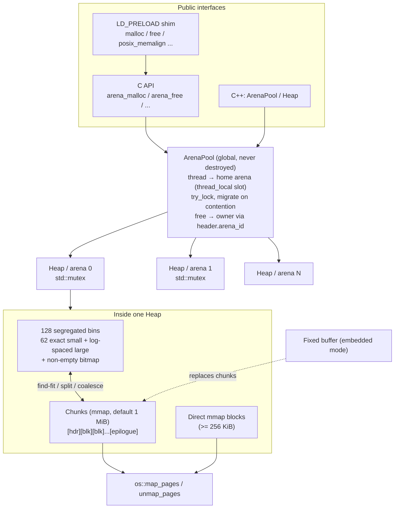
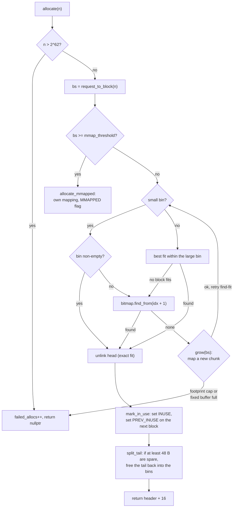
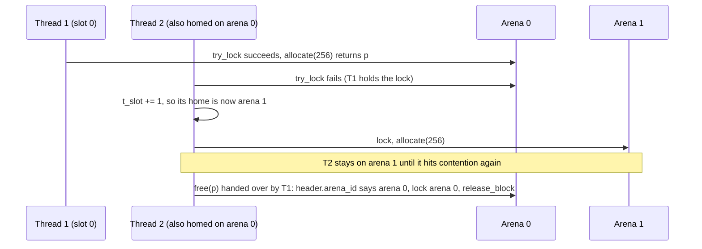

# ArenaAlloc

ArenaAlloc is a thread-safe, segregated-fit heap allocator written in C++17. It can replace
`malloc`/`free`/`calloc`/`realloc`/`aligned_alloc`, either through a C API or as an
`LD_PRELOAD` shim. It can also run entirely inside a static buffer for embedded targets
that have no OS heap. It ships with a benchmark harness that replays embedded-style
allocation traces against ArenaAlloc and the system `malloc`, and compares their
fragmentation and throughput ([example output](#example-output)).

## Features

- **Segregated free lists**: 62 exact-size small bins (48 B to 1 KiB in 16 B steps) plus
  128 total bins, with log-spaced large bins (4 sub-bins per power of two). A 128-bit
  bitmap finds the next non-empty bin in O(1).
- **Fit policy**: an exact fit for small requests, best fit within a large bin, otherwise
  the head of the next non-empty bin. Blocks are split, and the leftover tail goes back
  to the bins.
- **Immediate coalescing with boundary tags**: every free block has a header and a
  footer, and every block carries a `PREV_INUSE` bit. No two free blocks are ever
  adjacent. A chunk that becomes completely free is returned to the OS (one warm chunk
  is kept).
- **Thread safety**: a pool of independent arenas, each protected by its own
  `std::mutex`. A thread allocates from its home arena with `try_lock` and moves to
  another arena when it hits contention. A free always goes back to the owning arena,
  found from the arena id in the 16-byte block header, so freeing on a different thread
  is safe.
- **Large blocks** (256 KiB and up by default) are mapped directly with `mmap`.
- **Embedded mode**: `Heap(buffer, len)` carves the whole heap out of a caller-supplied
  buffer and never calls the OS.
- **Safety checks**: header magic, detection of double frees, foreign pointers and
  frees into the wrong pool, and `validate()`, which walks every chunk and bin and
  checks every invariant.
- **Stats**: footprint, peak footprint, in-use and free bytes, largest free block,
  external fragmentation and failed allocations.

## Architecture



Block layout (all sizes are multiples of 16):

```
 in use:  [ size|flags | arena_id | magic ][ payload ........................ ]
 free:    [ size|flags | arena_id | magic ][ next | prev ][ ... ][ size (footer) ]
           <------------- 16 B ----------->

 flags: INUSE | PREV_INUSE | MMAPPED      minimum block: 48 B
```

## How an allocation works

### Size classes

A request of `n` bytes becomes a block of `align_up(n + 16, 16)` bytes (at least 48), and
the block size picks the bin:

| Bins | Block sizes | How a bin is searched |
|---|---|---|
| 0–61 | 48 B to 1 KiB, one bin per 16 B step | Exact fit: take the head of the bin |
| 62–65 | 1 KiB to 2 KiB, four 256 B ranges | Best fit within the bin |
| 66–69 | 2 KiB to 4 KiB, four 512 B ranges | Best fit within the bin |
| … | each further power of two split into 4 sub-bins | Best fit within the bin |
| 94–97 | 256 KiB to 512 KiB | Only used in embedded mode or with a raised mmap threshold |
| 127 | 80 MiB and above (catch-all) | Best fit within the bin |

Some worked examples:

| Request | Block | Bin |
|---|---|---|
| `malloc(100)` | 128 B | 5 (exact) |
| `malloc(1000)` | 1024 B | 61 (last exact bin) |
| `malloc(3000)` | 3024 B | 67 (2560–3071 B) |
| `malloc(300000)` | n/a | direct `mmap`, above the 256 KiB threshold |

The bins are ordered, so any block in a higher bin is larger than the request. When the
request's own bin can't satisfy it, the 128-bit non-empty bitmap gives the next usable bin
with a single `ctz`, without walking any lists.

### The malloc path



### The free path and coalescing

```
deallocate(p):
  1. b = p - 16; abort on a bad magic, a clear INUSE bit (double free) or a
     foreign arena id
  2. MMAPPED?  -> munmap the whole mapping, done
  3. clear INUSE on b's own header
  4. next block free?               -> unlink it from its bin, absorb it
  5. PREV_INUSE clear on b?         -> read the footer in front of b, unlink the
                                       previous block, and let it absorb b
  6. write the merged header + footer, clear PREV_INUSE on the following block
  7. merged block spans a whole chunk (and it isn't the last chunk)?
                                    -> munmap the chunk
     otherwise                      -> push it onto the head of its bin
```

Freeing `B` when both neighbours are already free:

```
 before:  [ A free 96 ][ B in use 64 ][ C free 160 ][ D in use ... ]
 after:   [ A+B+C free 320                         ][ D in use, PREV_INUSE=0 ]
```

Step 3 is what makes double-free detection reliable. When `B` merges into `A`, its old
header is left behind inside `A`'s free payload. Because its INUSE bit was cleared first,
a second `free(B)` still aborts with "double free" and doesn't corrupt the bins.

### Which arena does the work



Allocations go to the calling thread's home arena. Frees always go to the arena that owns
the block, so a block can be allocated on one thread and freed on another.

## Project layout

```
include/arena/
  block.hpp         block header, flags, boundary-tag helpers
  size_class.hpp    bin indexing + non-empty bin bitmap
  heap.hpp          single arena (segregated fit, coalescing, stats, validate)
  arena_pool.hpp    multi-arena thread-safe pool
  arena_alloc.h     C API
  os_memory.hpp     mmap wrapper (malloc-free)
  stats.hpp         HeapStats + fragmentation metrics
src/                implementations + malloc_shim.c (LD_PRELOAD)
tests/              GoogleTest suites
bench/              trace generators, fragmentation + throughput benchmarks, runner script
```

## Building

Requirements: CMake 3.16 or newer, a C++17 compiler (GCC or Clang), and a POSIX OS
(Linux or macOS). The first configure downloads GoogleTest with `FetchContent`, so it
needs network access. No credentials or special hardware are required.

```bash
cmake -S . -B build -DCMAKE_BUILD_TYPE=Release
cmake --build build -j
```

Options: `-DARENAALLOC_BUILD_TESTS=OFF` and `-DARENAALLOC_BUILD_BENCH=OFF`.

## Running

### As a library

```cpp
#include "arena/arena_alloc.h"

void* p = arena_malloc(128);
p = arena_realloc(p, 4096);
arena_free(p);

arena_stats s;
arena_get_stats(&s);   // footprint, in_use_bytes, external_fragmentation, ...
```

Embedded mode, with no OS calls:

```cpp
#include "arena/heap.hpp"

alignas(16) static unsigned char pool[64 * 1024];
arena::Heap heap(pool, sizeof pool);
void* msg = heap.allocate(200);
heap.deallocate(msg);
```

### As a drop-in malloc (Linux)

```bash
LD_PRELOAD=./build/libarenaalloc_preload.so ls -la
ARENAALLOC_ARENAS=4 ARENAALLOC_CHUNK_KB=512 LD_PRELOAD=./build/libarenaalloc_preload.so ./your_app
```

| Variable | Meaning | Default |
|---|---|---|
| `ARENAALLOC_ARENAS` | number of arenas in the global pool | online CPUs (max 64) |
| `ARENAALLOC_CHUNK_KB` | chunk size requested from the OS | 1024 |
| `ARENAALLOC_MMAP_THRESHOLD_KB` | direct-mmap threshold | 256 |

The shim is Linux/glibc only. On macOS, replacing malloc requires registering a malloc
zone, which this project doesn't do.

### Benchmarks

```bash
# Fragmentation: one allocator per process, every workload
./build/arena_frag_bench --alloc arena  --workload all --ops 400000
./build/arena_frag_bench --alloc system --workload all --ops 400000

# Multi-threaded throughput (local = same-thread frees, handoff = cross-thread frees)
./build/arena_throughput_bench --alloc arena-pool --mode local   --threads 8
./build/arena_throughput_bench --alloc system     --mode handoff --threads 8

# Everything, with a side-by-side table
./bench/run_benchmarks.sh build 400000
```

The workloads are deterministic, seeded traces modelled on firmware-style allocation
patterns:

| Workload | Pattern |
|---|---|
| `sensor` | Small fixed-type packets (24 to 256 B) with random short lifetimes |
| `mixed` | Bimodal message buffers: 80% between 16 and 128 B, 20% between 1 and 8 KiB |
| `sawtooth` | Build-up and tear-down cycles that leave about 10% long-lived survivors, with the size mix drifting between cycles |
| `frames` | A ring of 16 to 64 KiB frames interleaved with small control structures |

**Fragmentation metric**: footprint-weighted overhead,
`sum(footprint - live_requested) / sum(footprint)`, sampled every 500 operations, plus
peak footprint divided by peak live bytes. The ArenaAlloc runs use a single 64 KiB-chunk
heap to mimic a constrained device. The system footprint comes from `mallinfo2()` on
glibc and `malloc_zone_statistics()` on macOS. macOS reserves memory in large regions,
so its numbers are coarse; run the comparison on Linux for meaningful results.

### Example output

Illustrative, not a recorded run: these numbers show the format and the rough shape to
expect on an 8-core x86-64 Linux box with glibc 2.35. Absolute values will differ on your
machine.

`./bench/run_benchmarks.sh build 400000`:

```
== Fragmentation (ops per workload: 400000) ==
workload   |  sys overhead%     arena ovh% | sys peak KiB   arena peak |   sys Mops arena Mops | overhead reduction
sensor     |          24.81          21.37 |          268          256 |      23.71      27.36 | +13.9%
mixed      |          18.92          14.06 |         5412         5056 |      17.94      19.20 | +25.7%
sawtooth   |          46.35          29.18 |         2148         1984 |      26.88      30.12 | +37.0%
frames     |          38.70          23.64 |         1284         1108 |       9.85      12.47 | +38.9%

== Throughput (mixed workload) ==
allocator=system mode=local workload=mixed threads=1 ops=204118 time=0.005s throughput=38.52 Mops/s
allocator=arena-pool mode=local workload=mixed threads=1 ops=204118 time=0.006s throughput=31.47 Mops/s
allocator=system mode=local workload=mixed threads=2 ops=408273 time=0.006s throughput=66.10 Mops/s
allocator=arena-pool mode=local workload=mixed threads=2 ops=408273 time=0.007s throughput=55.83 Mops/s
allocator=system mode=local workload=mixed threads=4 ops=816391 time=0.007s throughput=112.36 Mops/s
allocator=arena-pool mode=local workload=mixed threads=4 ops=816391 time=0.008s throughput=101.92 Mops/s
allocator=system mode=local workload=mixed threads=8 ops=1632740 time=0.010s throughput=171.05 Mops/s
allocator=arena-pool mode=local workload=mixed threads=8 ops=1632740 time=0.009s throughput=178.40 Mops/s
allocator=system mode=handoff workload=mixed threads=1 ops=204236 time=0.009s throughput=21.84 Mops/s
allocator=arena-pool mode=handoff workload=mixed threads=1 ops=204236 time=0.011s throughput=17.92 Mops/s
allocator=system mode=handoff workload=mixed threads=2 ops=204236 time=0.009s throughput=22.10 Mops/s
allocator=arena-pool mode=handoff workload=mixed threads=2 ops=204236 time=0.011s throughput=18.05 Mops/s
allocator=system mode=handoff workload=mixed threads=4 ops=408414 time=0.010s throughput=39.67 Mops/s
allocator=arena-pool mode=handoff workload=mixed threads=4 ops=408414 time=0.012s throughput=33.48 Mops/s
allocator=system mode=handoff workload=mixed threads=8 ops=816650 time=0.013s throughput=61.23 Mops/s
allocator=arena-pool mode=handoff workload=mixed threads=8 ops=816650 time=0.014s throughput=58.91 Mops/s
```

A single fragmentation run prints more detail. `./build/arena_frag_bench --alloc arena --workload sawtooth`:

```
[sawtooth / arena]
  ops               408017 in 0.014 s (30.12 Mops/s)
  peak live         1509 KiB
  peak footprint    1984 KiB  (1.315x live)
  overhead          29.18 %  (footprint-weighted, 1 - live/footprint)
  ext. frag (end)   0.00 %
```

Summary of the same run:

| Workload | glibc overhead | ArenaAlloc overhead | Reduction | Peak footprint (glibc → ArenaAlloc) |
|---|---|---|---|---|
| `sensor` | 24.8 % | 21.4 % | 14 % | 268 → 256 KiB |
| `mixed` | 18.9 % | 14.1 % | 26 % | 5412 → 5056 KiB |
| `sawtooth` | 46.4 % | 29.2 % | 37 % | 2148 → 1984 KiB |
| `frames` | 38.7 % | 23.6 % | 39 % | 1284 → 1108 KiB |
| **mean** | | | **~29 %** | |

### Reading the results

- **The overhead column is the main result.** It is the share of the OS footprint not
  holding live data, weighted by footprint, so it counts allocator headers, rounding,
  free holes and memory not yet returned to the OS. Lower is better.
- **`sensor` shows the smallest gain.** All of its sizes fit small bins in both
  allocators, and ArenaAlloc's 16-byte header costs more than glibc's 8-byte one on
  24–48 B packets.
- **`sawtooth` and `frames` show the largest gains.** glibc can only trim the top of its
  `sbrk` heap, so a few survivors pin the high-water mark. ArenaAlloc works in 64 KiB
  chunks and unmaps any chunk that becomes completely free. Frames larger than a chunk
  get a chunk of their own and go back to the OS when freed.
- **`ext. frag (end)` should be 0.00 %.** Every trace frees all of its blocks at the end,
  so this line checks that coalescing collapsed each surviving chunk back into a single
  free block. Any other value means a merge was missed.
- **Throughput isn't the goal.** glibc's per-thread `tcache` serves most requests without
  a lock, while every ArenaAlloc call takes its arena's mutex. Expect ArenaAlloc to be
  10–20 % slower single-threaded and around even at 8 threads in `local` mode. `handoff`
  is slower for both, because every free crosses threads. `threads=1` and `threads=2`
  are the same run in `handoff` mode (one producer/consumer pair).
- **Peak footprint is in whole chunks for ArenaAlloc.** In the default 64 KiB
  configuration, values are multiples of 64 KiB unless an oversized request mapped a
  chunk of its own.

| Symptom | Likely cause | What to try |
|---|---|---|
| ArenaAlloc overhead higher than glibc on tiny objects | 16 B header plus a 48 B minimum block | Expected for objects under 64 B; pool them in fixed-size slabs if they dominate |
| System numbers on macOS look far too high | `malloc_zone_statistics` reports whole reserved regions | Compare on Linux |
| Footprint climbs and never drops | Survivors pin every chunk, or `release_empty_chunks` is off | Smaller `--chunk-kb` so chunks empty more often |
| `failed allocs` appears | `max_footprint` cap or a full fixed buffer | Raise the cap or the buffer size; check peak live against capacity |
| `arena-pool` scales poorly in `local` mode | Fewer arenas than threads, so threads migrate and contend | `--arenas` (or `ARENAALLOC_ARENAS`) at least equal to the thread count |
| `valid=NO` after a throughput run | Heap corruption: a missed coalesce or a broken free list | Rebuild with `-fsanitize=address,undefined` and run `ctest` |

## Design decisions

| Decision | Choice | Rationale |
|---|---|---|
| Size classes | 62 exact 16 B bins, then 4 log-spaced bins per power of two | Exact fit with no search for the sizes embedded code uses most, while keeping each large bin short enough that best fit scans only a few blocks |
| Bin lookup | 128-bit non-empty bitmap | Finding the next usable bin is one `ctz`, not a list walk |
| Coalescing | Immediate, with boundary tags | O(1) merges in both directions, and no two free blocks are ever adjacent, so `validate()` can check it |
| Block header | 16 B with arena id and magic | Keeps payloads 16-byte aligned, lets any thread find the owning arena, and catches foreign and double frees |
| OS memory | `mmap`'d chunks (1 MiB default) | Unlike `sbrk`, any empty chunk can go back to the OS, not just the top of the heap |
| Large blocks | Direct `mmap` at 256 KiB and up | Large buffers never fragment the chunks, and freeing one returns its memory at once |
| Thread safety | One mutex per arena, `try_lock` migration | Simple to reason about, and spreads contending threads without per-thread caches |
| Embedded mode | Same `Heap` over a caller's buffer | One code path and one test suite for both hosted and bare-metal use |

## Testing

```bash
cmake -S . -B build -DCMAKE_BUILD_TYPE=Debug
cmake --build build -j
ctest --test-dir build --output-on-failure
# or run the binary directly
./build/tests/arenaalloc_tests --gtest_filter='Pool.*'
```

The suites cover:

- `test_size_class`: request rounding, bin monotonicity, bitmap search.
- `test_heap_basic`: alignment, non-overlap, full coalesce-back, the mmap path, the
  footprint cap, and death tests for double frees (including a block already merged
  into its free predecessor) and foreign pointers.
- `test_coalesce`: forward and backward merging, exact-bin reuse, splitting, empty-chunk
  release, and a 20k-operation randomized stress run with `validate()` checkpoints.
- `test_realloc_aligned`: in-place grow and shrink, moves, C semantics, alignments from
  32 B to 64 KiB.
- `test_fixed_buffer`: exhausting the buffer, no mmap fallback, misaligned buffers.
- `test_pool_threads`: 8-thread stress runs, producer/consumer cross-thread frees and
  reallocs, and a death test for freeing into the wrong pool.
- `test_c_api`: the C API against the global pool.

For extra safety, configure with
`-DCMAKE_CXX_FLAGS="-fsanitize=undefined -fno-omit-frame-pointer"` (ThreadSanitizer also
works for the pool tests).

## Limitations

- Each arena takes a single lock. There are no lock-free per-thread caches, so
  cross-thread frees contend on the owner's mutex.
- Freed memory is never handed between arenas except by unmapping whole chunks.
- Requires a GCC- or Clang-compatible compiler (it uses `__builtin_clzll` and
  `__builtin_ctzll`).
