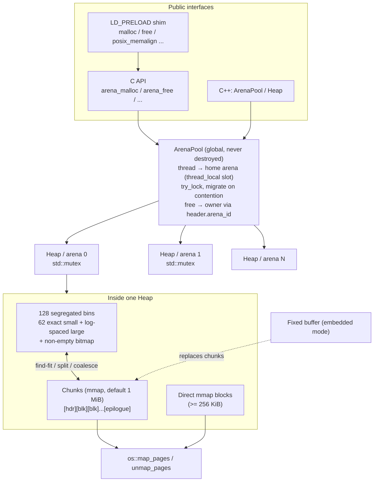

# ArenaAlloc

ArenaAlloc is a thread-safe, segregated-fit heap allocator written in C++17. It can replace
`malloc`/`free`/`calloc`/`realloc`/`aligned_alloc`, either through a C API or as an
`LD_PRELOAD` shim. It can also run entirely inside a static buffer for embedded targets
that have no OS heap. It ships with a benchmark harness that replays embedded-style
allocation traces against ArenaAlloc and the system `malloc`, and compares their
fragmentation and throughput.

## Features

- **Segregated free lists**: 62 exact-size small bins (48 B to 1 KiB in 16 B steps) plus
  128 total bins, with log-spaced large bins (4 sub-bins per power of two). A 128-bit
  bitmap finds the next non-empty bin in O(1).
- **Fit policy**: an exact fit for small requests, best fit within a large bin, otherwise
  the head of the next non-empty bin. Blocks are split, and the leftover tail goes back
  to the bins.
- **Immediate coalescing with boundary tags**: every free block has a header and a
  footer, and every block carries a `PREV_INUSE` bit. No two free blocks are ever
  adjacent. A chunk that becomes completely free is returned to the OS (one warm chunk
  is kept).
- **Thread safety**: a pool of independent arenas, each protected by its own
  `std::mutex`. A thread allocates from its home arena with `try_lock` and moves to
  another arena when it hits contention. A free always goes back to the owning arena,
  found from the arena id in the 16-byte block header, so freeing on a different thread
  is safe.
- **Large blocks** (256 KiB and up by default) are mapped directly with `mmap`.
- **Embedded mode**: `Heap(buffer, len)` carves the whole heap out of a caller-supplied
  buffer and never calls the OS.
- **Safety checks**: header magic, detection of double frees, foreign pointers and
  frees into the wrong pool, and `validate()`, which walks every chunk and bin and
  checks every invariant.
- **Stats**: footprint, peak footprint, in-use and free bytes, largest free block,
  external fragmentation and failed allocations.

## Architecture



Block layout (all sizes are multiples of 16):

```
 in use:  [ size|flags | arena_id | magic ][ payload ........................ ]
 free:    [ size|flags | arena_id | magic ][ next | prev ][ ... ][ size (footer) ]
           <------------- 16 B ----------->

 flags: INUSE | PREV_INUSE | MMAPPED      minimum block: 48 B
```

## Project layout

```
include/arena/
  block.hpp         block header, flags, boundary-tag helpers
  size_class.hpp    bin indexing + non-empty bin bitmap
  heap.hpp          single arena (segregated fit, coalescing, stats, validate)
  arena_pool.hpp    multi-arena thread-safe pool
  arena_alloc.h     C API
  os_memory.hpp     mmap wrapper (malloc-free)
  stats.hpp         HeapStats + fragmentation metrics
src/                implementations + malloc_shim.c (LD_PRELOAD)
tests/              GoogleTest suites
bench/              trace generators, fragmentation + throughput benchmarks, runner script
```

## Building

Requirements: CMake 3.16 or newer, a C++17 compiler (GCC or Clang), and a POSIX OS
(Linux or macOS). The first configure downloads GoogleTest with `FetchContent`, so it
needs network access. No credentials or special hardware are required.

```bash
cmake -S . -B build -DCMAKE_BUILD_TYPE=Release
cmake --build build -j
```

Options: `-DARENAALLOC_BUILD_TESTS=OFF` and `-DARENAALLOC_BUILD_BENCH=OFF`.

## Running

### As a library

```cpp
#include "arena/arena_alloc.h"

void* p = arena_malloc(128);
p = arena_realloc(p, 4096);
arena_free(p);

arena_stats s;
arena_get_stats(&s);   // footprint, in_use_bytes, external_fragmentation, ...
```

Embedded mode, with no OS calls:

```cpp
#include "arena/heap.hpp"

alignas(16) static unsigned char pool[64 * 1024];
arena::Heap heap(pool, sizeof pool);
void* msg = heap.allocate(200);
heap.deallocate(msg);
```

### As a drop-in malloc (Linux)

```bash
LD_PRELOAD=./build/libarenaalloc_preload.so ls -la
ARENAALLOC_ARENAS=4 ARENAALLOC_CHUNK_KB=512 LD_PRELOAD=./build/libarenaalloc_preload.so ./your_app
```

| Variable | Meaning | Default |
|---|---|---|
| `ARENAALLOC_ARENAS` | number of arenas in the global pool | online CPUs (max 64) |
| `ARENAALLOC_CHUNK_KB` | chunk size requested from the OS | 1024 |
| `ARENAALLOC_MMAP_THRESHOLD_KB` | direct-mmap threshold | 256 |

The shim is Linux/glibc only. On macOS, replacing malloc requires registering a malloc
zone, which this project doesn't do.

### Benchmarks

```bash
# Fragmentation: one allocator per process, every workload
./build/arena_frag_bench --alloc arena  --workload all --ops 400000
./build/arena_frag_bench --alloc system --workload all --ops 400000

# Multi-threaded throughput (local = same-thread frees, handoff = cross-thread frees)
./build/arena_throughput_bench --alloc arena-pool --mode local   --threads 8
./build/arena_throughput_bench --alloc system     --mode handoff --threads 8

# Everything, with a side-by-side table
./bench/run_benchmarks.sh build 400000
```

The workloads are deterministic, seeded traces modelled on firmware-style allocation
patterns:

| Workload | Pattern |
|---|---|
| `sensor` | Small fixed-type packets (24 to 256 B) with random short lifetimes |
| `mixed` | Bimodal message buffers: 80% between 16 and 128 B, 20% between 1 and 8 KiB |
| `sawtooth` | Build-up and tear-down cycles that leave about 10% long-lived survivors, with the size mix drifting between cycles |
| `frames` | A ring of 16 to 64 KiB frames interleaved with small control structures |

**Fragmentation metric**: footprint-weighted overhead,
`sum(footprint - live_requested) / sum(footprint)`, sampled every 500 operations, plus
peak footprint divided by peak live bytes. The ArenaAlloc runs use a single 64 KiB-chunk
heap to mimic a constrained device. The system footprint comes from `mallinfo2()` on
glibc and `malloc_zone_statistics()` on macOS. macOS reserves memory in large regions,
so its numbers are coarse; run the comparison on Linux for meaningful results.

## Testing

```bash
cmake -S . -B build -DCMAKE_BUILD_TYPE=Debug
cmake --build build -j
ctest --test-dir build --output-on-failure
# or run the binary directly
./build/tests/arenaalloc_tests --gtest_filter='Pool.*'
```

The suites cover:

- `test_size_class`: request rounding, bin monotonicity, bitmap search.
- `test_heap_basic`: alignment, non-overlap, full coalesce-back, the mmap path, the
  footprint cap, and death tests for double frees and foreign pointers.
- `test_coalesce`: forward and backward merging, exact-bin reuse, splitting, empty-chunk
  release, and a 20k-operation randomized stress run with `validate()` checkpoints.
- `test_realloc_aligned`: in-place grow and shrink, moves, C semantics, alignments from
  32 B to 64 KiB.
- `test_fixed_buffer`: exhausting the buffer, no mmap fallback, misaligned buffers.
- `test_pool_threads`: 8-thread stress runs, producer/consumer cross-thread frees and
  reallocs, and a death test for freeing into the wrong pool.
- `test_c_api`: the C API against the global pool.

For extra safety, configure with
`-DCMAKE_CXX_FLAGS="-fsanitize=undefined -fno-omit-frame-pointer"` (ThreadSanitizer also
works for the pool tests).

## Limitations

- Each arena takes a single lock. There are no lock-free per-thread caches, so
  cross-thread frees contend on the owner's mutex.
- Freed memory is never handed between arenas except by unmapping whole chunks.
- Requires a GCC- or Clang-compatible compiler (it uses `__builtin_clzll` and
  `__builtin_ctzll`).
